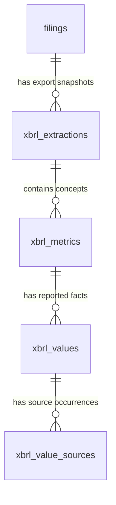

# XBRL database schema

This schema stores the **yearly API/XBRL metrics exports** described in
[the API metrics guide](API_EXTRACTION_TABLE_OUTPUT_METRICS_GUIDE.md).
The SQL is [db/init/04_xbrl_data.sql](../db/init/04_xbrl_data.sql).
It supports `api-metrics-1.0`, including comparative periods, dimensional facts,
nil values, accuracy variants and several source occurrences for one value.

The schema and [JSON loader](../scripts/load_xbrl_to_postgres.py) are implemented.
The single-year and batch API extraction commands save each yearly JSON to
PostgreSQL automatically, while keeping the export in `data/table_output/<company>/`.
Use `--no-db` on those commands for file-only extraction.

To retrieve existing records, use
[`scripts/export_xbrl_from_postgres.py`](../scripts/export_xbrl_from_postgres.py).
It lists snapshots and exports one selected snapshot as JSON or one-value-per-row
CSV, without API calls or database writes. See
[export commands and output details](table_extraction_usage.md#export-existing-xbrl-data-from-docker).

## Relationships



| Table | One row represents | Primary key |
| --- | --- | --- |
| `filings` (existing) | A company, fiscal year and form type | `filing_id` |
| `xbrl_extractions` | One yearly export snapshot | `extraction_id` |
| `xbrl_metrics` | One exact US-GAAP concept in that snapshot | `(extraction_id, concept)` |
| `xbrl_values` | One original entry in the metric's `value[]` | `(extraction_id, concept, value_index)` |
| `xbrl_value_sources` | One original entry in the value's `source_labels[]` | `(extraction_id, concept, value_index, source_index)` |

Deleting a filing cascades through its XBRL records. Source fact IDs and XPath
locators are evidence fields, not global primary keys.

## Columns and JSON mapping

### `xbrl_extractions`

| Column | Type | Mapping |
| --- | --- | --- |
| `extraction_id` | bigserial | Internal key for the export snapshot |
| `filing_id` | bigint FK | Existing filing, identified using the repository's company slug, source fiscal year and form type |
| `file_path` | text | Path of the metrics JSON being loaded |
| `file_sha256` | text | SHA-256 of the original file bytes, before parsing |
| `export_schema_version`, `exporter_version` | text | File's `schema_version` and `exporter_version` |
| `taxonomy_year` | integer | Official dictionary version used by this export |
| `requested_items` | text[] | File's selected SEC Items |
| `metadata` | jsonb | All original top-level properties except `metrics`, including company name, source paths, counts, notes and verification |
| `loaded_at` | timestamptz | Time this snapshot was stored |

`UNIQUE (filing_id, file_sha256)` gives a loader an idempotent lookup: the same
file bytes for the same filing reuse the same extraction. Different exports for
one filing can coexist, including different Item selections and exporter versions.
Queries must select the intended `extraction_id`; counting several alternative
exports together can repeat the same facts. This schema does not automatically
choose a preferred snapshot.

Preserve the SEC identity, accession and document hashes inside the original
`metadata.verification`. The existing `filings` table groups by company/year/form;
it does not distinguish accession numbers. Validate the export's verified issuer,
fiscal year and form before linking it to that row.

### `xbrl_metrics`

`concept` is the exact identifier, such as `us-gaap:NetIncomeLoss`. Keep each
filing's own `query_name`, `label`, nullable `definition`, taxonomy `period_type`
and `scope`. Do not merge concepts by similar labels or replace older definitions
with a newer filing's definition.

The remaining columns preserve `company_wide_annual_or_year_end_years` as
`integer[]`, and `units`, `api_groups` and `items` as `text[]`.
`metric_index` is the zero-based index in `metrics[]`; it preserves source order.
`extra` holds properties not mapped to named columns, excluding `value`.

API groups describe the API organization. The current XBRL export does not
establish printed table boundaries, so there is no table-layout entity here.

### `xbrl_values`

| Column | Type | Mapping |
| --- | --- | --- |
| `value_index` | integer | Zero-based index in this metric's `value[]` |
| `value_text` | text, nullable | Original decimal amount; SQL NULL for an explicit nil fact |
| `amount` | numeric, generated | Exact numeric cast of `value_text`, without a fixed rounding scale |
| `unit` | text | Original XBRL unit, e.g. `USD`, `shares` or `USD/shares` |
| `status` | text | `reported` or `nil` |
| `instant_date` | date, nullable | `period.instant` |
| `period_start_date`, `period_end_date` | date, nullable | `period.startDate` and `period.endDate` |
| `dimensions` | jsonb array | Original explicit axis/member pairs; `[]` means no explicit dimensions |
| `decimals`, `precision` | jsonb, nullable | Original scalar accuracy metadata, retaining string/number/null types |
| `items` | text[] | This value's verified Item memberships |
| `extra` | jsonb | Unmapped value properties, excluding `source_labels` |

Use `Decimal` when parsing/converting amounts. Do not pass them through a binary
float. Values are already in their XBRL unit: **`decimals` describes accuracy and
must not multiply the amount**. Text accuracy values such as `"INF"` remain valid.
SQL NULL in an accuracy column means the key was absent; JSON `null` means it was
explicitly present with a null value.

The database checks that reported amounts are finite and non-null, nil amounts
are null, and each period is either one instant or a complete start/end pair.
Reversed durations are rejected. A reported zero and an explicit nil are distinct.
Dimensions must be an array of nonempty axis/member pairs with no repeated axis.

The source filing year comes from `filings.fiscal_year`. It is separate from the
value's reporting dates and the extraction's taxonomy year. For example, a FY2025
filing can report a 2023 duration. Keep every such comparative record.
The metric's `period_type` describes the taxonomy concept; the actual value's
period is stored independently, as the exporter currently does.

There is deliberately no uniqueness constraint on concept/period/unit/dimensions:
the exporter can retain conflicting amounts or different accuracy records in the
same context. The ordinal key preserves them without guessing which is correct.
For comparisons, canonicalize dimensions by axis/member, since array order is
not significant. An empty dimension array does not imply a row labelled Total.

### `xbrl_value_sources`

Store each occurrence's `document_id`, `source`, printed `page`, `source_fact_id`,
`source_locator`, `row_label`, `column_label` and `label_method` as nullable text.
Pages are text because a filing can use labels such as `F-1`.
The source JSON's `status` maps to `label_status`: `resolved`, `partial`,
`unresolved`, `not_in_table` or `source_not_found`.
`extra` preserves any other occurrence properties.

An absent document ID means the implicit primary document in a single-document
export. The same fact ID may occur in different filings or documents. A value
with two supporting occurrences is still **one value**, not two amounts.
Label resolution and the value's reported/nil status are independent.

## Apply and inspect

Start Docker PostgreSQL with `docker compose up -d`. On a fresh volume, the init
SQL runs automatically. On an existing database, the XBRL loader automatically
installs its missing tables. The migration can also be applied manually:

```bash
docker compose exec -T db psql -X -v ON_ERROR_STOP=1 -U sec -d sec_disclosure < db/init/04_xbrl_data.sql
```

Use your configured PostgreSQL user/database if different from these defaults.
The migration is transactional and can be rerun. It requires the existing
`filings` and `schema_info` tables from `01_schema.sql` and does not require the
disclosure embedding migration. It records `xbrl_schema_version = 1` separately
in `schema_info`, without changing the existing `schema_version` marker.

`xbrl_value_context` joins values with filing, extraction and metric metadata.
It has one row per value and does not expand source occurrences:

```sql
-- Find available exports first; select the extraction_id(s) you want to query.
SELECT e.extraction_id, f.company, f.fiscal_year, e.taxonomy_year,
       e.requested_items, e.file_path
FROM xbrl_extractions e JOIN filings f USING (filing_id)
ORDER BY f.company, f.fiscal_year, e.extraction_id;

-- Substitute a selected extraction ID for 123.
SELECT source_filing_year, period_start_date, period_end_date,
       amount, unit, status, dimensions
FROM xbrl_value_context
WHERE extraction_id = 123 AND concept = 'us-gaap:NetIncomeLoss'
ORDER BY period_end_date, value_index;

-- Original source occurrences for a selected value.
SELECT COALESCE(document_id, 'primary') AS document_id,
       page, row_label, column_label, source_fact_id, source_locator, label_status
FROM xbrl_value_sources
WHERE extraction_id = 123 AND concept = 'us-gaap:NetIncomeLoss' AND value_index = 0
ORDER BY source_index;
```

## Loading and validation

The loader verifies the cached API response and filing hashes, company identity,
fiscal year and form type before writing. It checks Items, concepts, dimensions,
periods, finite amounts, label statuses and record counts. It uses one transaction
per yearly snapshot, including its filing row, and reuses the same snapshot when
identical bytes are loaded again. Unknown properties remain in `extra`.
These checks validate storage and source binding; they do not rerun the full
extraction or prove every exported amount is correctly tagged in the source.

Connection settings come from the shell or repository `.env` (`override=False`).
`DATABASE_URL` takes precedence. Otherwise use `POSTGRES_HOST`, `POSTGRES_PORT`,
`POSTGRES_USER`, `POSTGRES_PASSWORD` and `POSTGRES_DB`; defaults match Docker Compose.
Database readiness is checked before new extraction/API requests. A failed save
returns a nonzero status and keeps the JSON. Rerunning the single-year or batch
command imports existing files without downloading again. Imports check the
export and its original cached sources, so keep those caches available.

To import or check a previously generated yearly file directly:

```bash
.venv/bin/python scripts/load_xbrl_to_postgres.py --company Intel --year 2025
.venv/bin/python scripts/load_xbrl_to_postgres.py --company Intel --year 2025 --dry-run
```

Use `--file PATH` for another location and `--cik CIK` to require a particular
issuer. Use the same company slug as the text loaders to link both sides to the
same `filings` row. The loader preserves existing text-side filing/source data.

Store the yearly exports as the source records. The
[merged API output](MERGED_API_METRICS_GUIDE.md) is a derived selection across
filings, with its own conflict policy. It should not be inserted again as another
yearly export or overwrite the original records. Its retained values can later be
represented by references to these keys if merge storage is needed.

Run the opt-in integration tests with Docker running:

```bash
SEC_XBRL_DB_INTEGRATION=1 PYTHONPATH=tests:src .venv/bin/python -m unittest test_xbrl_schema test_load_xbrl_to_postgres
```

The tests create and remove a separate temporary database. They check repeatable
migration, exact decimals, nil versus zero, period/dimension validation, snapshot
identity, foreign keys, source multiplicity, cascading deletion, loader idempotency
and complete rollback after a late insert failure. They do not
load or modify the project's `sec_disclosure` database.
