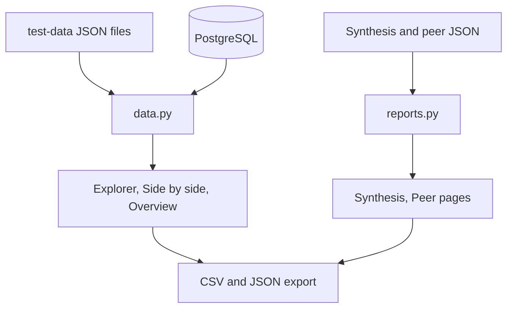

# YUVIKA: UI dashboard

**Maintainer:** YUVIKA — contact YUVIKA for questions about the dashboard.

## 1. Purpose and implementation status

A Streamlit app that lets a reader explore what changed in a company's 10-K from one year to the next and check the source text behind each change. It reads the saved results of the pipeline (aligned disclosures with change labels and materiality) and the outputs of the synthesis and peer comparison agents. It covers user story 9: filters, side-by-side comparison, synthesis and peer views, evidence access, export, and clear loading, empty and error states.

Implemented:

- **Overview** (`app/Home.py`): counts and charts for one company and year pair.
- **Change explorer**: filter by SEC Item, content category, change label, materiality, match status, match type and free text; click a row for the reasoning; export the filtered rows as CSV or JSON.
- **Side by side**: earlier and later disclosure text next to each other, with words removed (red, struck through) and added (green, underlined). One-sided matches show "No counterpart found". Sentence IDs, disclosure IDs and SEC links are listed under the text.
- **Synthesis report**: reads the synthesis agent's JSON, shows each finding with its cited evidence, financial figures, limitations and validation result; downloads as Markdown, evidence CSV and JSON.
- **Peer comparison**: reads the peer agent's `peer_comparison.json`, shows each target disclosure against each peer with the cited sentences on both sides; downloads as Markdown, CSV and JSON.
- Two data sources behind one data layer (`app/sec_ui/data.py`): the JSON files on the `test-data` branch, or PostgreSQL through `sec_disclosure.storage.exports`.

Not implemented (planned): the chatbot (Aarav), any live agent runs from the UI (the app only reads saved outputs), user accounts and saving of user notes, and human review actions on `needs_review` matches.

Verification: see section 8.

## 2. Code and workflow

| File | Responsibility |
| --- | --- |
| `app/Home.py` | Overview page and the entry point. |
| `app/pages/1_Change_Explorer.py` ... `4_Peer_Comparison.py` | One file per page. |
| `app/sec_ui/config.py` | Data folders, environment variables, company names. |
| `app/sec_ui/data.py` | Finds data, loads a comparison, flattens each alignment into one record, filters and exports. No Streamlit code. |
| `app/sec_ui/diff.py` | Word-level text comparison with escaped HTML. No Streamlit code. |
| `app/sec_ui/reports.py` | Loaders and flatteners for the synthesis and peer outputs. If an agent changes its JSON layout, change only this file. |
| `app/sec_ui/components.py` | Shared sidebar, filters, caching and styling. |



Everything is local computation. There are no model or API calls. Loaded comparisons are cached for 15 minutes; the sidebar button "Reload data" clears the cache.

## 3. Setup

Python 3.11 or newer and the packages in `requirements.txt` (the dashboard adds `streamlit>=1.50,<2`). No keys are needed.

```bash
pip install -r requirements.txt
git fetch origin test-data
git worktree add ../sec-filings-test-data origin/test-data   # about 227 MiB, once
streamlit run app/Home.py
```

The app finds `../sec-filings-test-data/test_data` by itself. Optional environment variables:

| Variable | Meaning |
| --- | --- |
| `SEC_UI_DATA_SOURCE` | `auto` (default: database if it has completed runs, otherwise files), `files`, or `postgres`. |
| `SEC_UI_ALIGNMENTS_DIR`, `SEC_UI_DISCLOSURES_DIR` | Folders laid out as `<company>/<previous>-<current>/alignments.json` and `<company>/<year>/disclosures.json`. |
| `SEC_UI_SYNTHESIS_DIRS` | Folders holding synthesis output JSON (default `data/synthesis`, `synthesis_dev`, `tests/fixtures/synthesis`). |
| `SEC_UI_PEER_DIR` | Folder laid out as `<TICKER>/<YEAR>/peer_comparison.json` (default `data/peer_comparison`). |
| `POSTGRES_*` or `DATABASE_URL` | Database settings, as in [database setup](YUVIKA_database_docker_setup.md). |

To use PostgreSQL: `docker compose up -d`, load disclosures and an alignment run with the loaders described in [how to add a table](YUVIKA_how_to_add_a_table.md), then `SEC_UI_DATA_SOURCE=postgres streamlit run app/Home.py`.

## 4. Inputs

- Aligned disclosures: `alignments.json` (and `needs_review.json` when present) per company and year pair, as written by the alignment, change-analysis and materiality stages. Full text comes from `disclosures.json`. Without it the side-by-side page shows only the sentences cited as evidence and says so.
- Synthesis output: one JSON file per company, with `report`, `source_catalog`, `financial_metrics`, `financial_trends`, `validation`.
- Peer output: `peer_comparison.json` (schema version 2) from `scripts/compare_peer_disclosures.py`.

## 5. Run and rerun

`streamlit run app/Home.py`, then open the address it prints. The app only reads data, so it is safe to rerun at any time. After new results are written, click "Reload data" in the sidebar. To preview the peer page before real peer output exists, point `SEC_UI_PEER_DIR` at `tests/fixtures/peer_comparison`; the page shows a banner because that file is made-up sample text.

## 6. Final output JSON structure

The dashboard writes no pipeline output. Its exports are:

- Change CSV and JSON: one row per match with `match_id`, `company`, years, `item`, `sections`, `content_category`, `relationship`, `status`, the lexical, semantic and LLM labels, the final `change_label`, `materiality`, scores, `key_change`, reasons, `previous_disclosure_ids`, `current_disclosure_ids`, `sentence_ids`, `source_urls` and (optional) both texts.
- Synthesis downloads: Markdown report, evidence CSV (one row per cited sentence with its finding, sentence ID and SEC URL), the original JSON.
- Peer downloads: Markdown report, CSV (one row per target disclosure and peer, with sentence IDs and URLs), the original JSON.

## 7. Example data and downstream usage

`tests/fixtures/alignments/amd` (alignment files only), `tests/fixtures/synthesis` (the synthesis agent's real AMD 2023-2025 output) and `tests/fixtures/peer_comparison` (made-up wording around real cited sentences, marked `_sample_data`). The record layout is documented in the `normalise` function of `app/sec_ui/data.py`. The chatbot can reuse `data.load_comparison` and `data.filter_records` without Streamlit.

## 8. Validation and limitations

Checked: 26 data-layer tests and 15 headless page tests (`tests/test_ui_data.py`, `tests/test_ui_pages.py`). Most run without keys or the test-data branch; one uses the real data when the worktree is present, and one compares PostgreSQL with files when `SEC_UI_TEST_POSTGRES=1` and a database holding AMD 2024-2025 are available. AMD 2024-2025 loads 432 matches (387 aligned + 45 needing review) and gives identical records from files and from PostgreSQL. The pages were also opened in a browser against all of this.

Limitations:

- "No counterpart found" means the saved comparison found none, not that the topic is absent from the whole filing.
- Change labels, materiality and peer statements are model output. The dashboard shows them as saved and does not re-check them.
- Synthesis "citation check passed" means IDs exist, not that the claims follow from the text.
- The peer page has only been run on made-up sample output, because no real peer output is committed yet.
- The PostgreSQL check used a database without the pgvector extension (the vector tables are not needed by the dashboard); a database created from the full Docker image was not tested here.
- Tested on Python 3.13 and Streamlit 1.66. The Python 3.14 setup used by the team was not tested.
- Very large comparisons (Citigroup has about 1,100 matches) load in under a second from files; the first PostgreSQL load of a large pair has not been timed.
