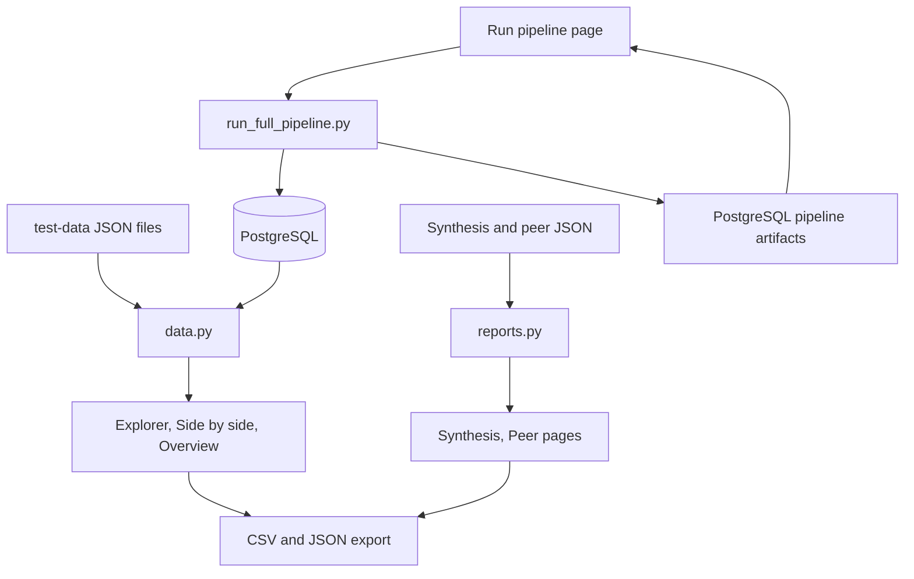

# YUVIKA: UI dashboard

**Maintainer:** YUVIKA — contact YUVIKA for questions about the dashboard. 

**Run pipeline + Peer Comparison UI:** JING LE

## 1. Purpose and implementation status

A Streamlit app that lets a reader explore what changed in a company's 10-K from one year to the next and check the source text behind each change. It reads the saved results of the pipeline (aligned disclosures with change labels and materiality) and the outputs of the synthesis and peer comparison agents. It covers user story 9: filters, side-by-side comparison, synthesis and peer views, evidence access, export, and clear loading, empty and error states.

Implemented:

- **Overview** (`app/Home.py`): counts and charts for one company and year pair.
- **Change explorer**: filter by SEC Item, content category, change label, materiality, match status, match type and free text using controls in the page; click a row for the reasoning; export the filtered rows as CSV or JSON.
- **Side by side**: earlier and later disclosure text next to each other, with words removed (red, struck through) and added (green, underlined). Filters appear in the page above the disclosure selector, while company and years remain in the sidebar. One-sided matches show "No counterpart found". Sentence IDs, disclosure IDs and SEC links are listed under the text.
- **Synthesis report**: reads the synthesis agent's JSON, shows each finding with its cited evidence, financial figures, limitations and validation result; downloads as Markdown, evidence CSV and JSON.
- **Peer comparison**: checks saved company/year prerequisites, launches or resumes `run_peer_comparison_pipeline.py` in the background, and polls comparison counts and the activity log. Reads PostgreSQL reports or local exports, shows cited sentences on both sides, and downloads Markdown, CSV and JSON.
- **Run pipeline**: accepts a ticker and comma-separated fiscal years (1900-2200), shows the exact comparison pairs, confirms selections spanning more than two years, and starts or resumes `run_full_pipeline.py` in the background. Shows all six phases through synthesis, PostgreSQL saves, activity logs, and an in-app completion or failure notice. Filing-section recovery and download-timeout retries are automatic inside the extractor.
- Two data sources behind one data layer (`app/sec_ui/data.py`): the JSON files on the `test-data` branch, or PostgreSQL through `sec_disclosure.storage.exports`.

Not implemented (planned): the chatbot (Aarav), user accounts and saving of user notes, and human review actions on `needs_review` matches.

Verification: see section 8.

## 2. Code and workflow

| File | Responsibility |
| --- | --- |
| `app/Home.py` | Overview page and the entry point. |
| `app/pages/0_Run_Pipeline.py` ... `4_Peer_Comparison.py` | One file per page; the run page launches and monitors the full pipeline. |
| `app/sec_ui/pipeline_runs.py` | Safe local subprocess launch, persisted UI job state, console-log tail, PostgreSQL checkpoint reads, and mapping of database saves to pipeline phases. |
| `app/sec_ui/peer_runs.py` | Peer prerequisites using backend validation, background peer CLI launch, progress polling, and PostgreSQL report reads. |
| `app/sec_ui/config.py` | Data folders, environment variables, company names. |
| `app/sec_ui/data.py` | Finds data, loads a comparison, flattens each alignment into one record, filters and exports. No Streamlit code. |
| `app/sec_ui/diff.py` | Word-level text comparison with escaped HTML. No Streamlit code. |
| `app/sec_ui/reports.py` | Loaders and flatteners for the synthesis and peer outputs. If an agent changes its JSON layout, change only this file. |
| `app/sec_ui/components.py` | Shared sidebar, filters, caching and styling. |



The overview, explorer, side-by-side and synthesis report pages remain read-only. Peer comparison can launch its separate backend after checking prerequisites. The Run pipeline page starts the existing CLI, which makes SEC and model API calls and saves results to PostgreSQL. Every three seconds it reads the runner's `status.json` artifact from PostgreSQL's `main` namespace and clears the comparison cache when the run completes. While running, it shows a spinner and stage-level progress from saved extraction batch/check checkpoints, alignment matching/verification jobs, and materiality row counts. Legacy local progress is used only when no database status exists for that selection; missing database checkpoints are never filled from stale local files. The bars count completed work units, not elapsed time or an ETA. Loaded comparisons are otherwise cached for 15 minutes; the sidebar button "Reload data" clears the cache.

## 3. Setup

Python 3.11 or newer and the packages in `requirements.txt` (the dashboard adds `streamlit>=1.50,<2`). Browsing saved data needs no API keys; starting a run requires PostgreSQL, `SEC_USER_AGENT`, `SEC_API_KEY`, and the SoCLaaS settings described in [the full pipeline guide](ZIYANG_full_pipeline.md).

```bash
pip install -r requirements.txt
git fetch origin test-data
git worktree add ../sec-filings-test-data origin/test-data   # about 227 MiB, once
streamlit run app/Home.py
```

The app finds `../sec-filings-test-data/test_data` by itself. Optional environment variables:

| Variable | Meaning |
| --- | --- |
| `SEC_UI_DATA_SOURCE` | `auto` (default: database if it has completed runs, otherwise files), `files`, or `postgres`. |
| `SEC_UI_ALIGNMENTS_DIR`, `SEC_UI_DISCLOSURES_DIR` | Folders laid out as `<company>/<previous>-<current>/alignments.json` and `<company>/<year>/disclosures.json`. |
| `SEC_UI_SYNTHESIS_DIRS` | Folders holding synthesis output JSON (default `data/synthesis`, `synthesis_dev`, `tests/fixtures/synthesis`). |
| `SEC_UI_PEER_DIR` | Folder laid out as `<TICKER>/<YEAR>/peer_comparison.json` (default `data/peer_comparison`). |
| `POSTGRES_*` or `DATABASE_URL` | Database settings, as in [database setup](YUVIKA_database_docker_setup.md). |

To start a run from the UI, configure `.env` as in the full pipeline guide, start the database with `docker compose up -d`, then run the dashboard:

```bash
.venv/bin/python -m streamlit run app/Home.py --server.address 127.0.0.1
```

The Run Pipeline page can launch jobs directly. It shows the active UI-launched pipeline even if another ticker or year selection is entered, and disables new launches until that process exits. To browse existing PostgreSQL results, set `SEC_UI_DATA_SOURCE=postgres`; the default `auto` mode also prefers completed database results over files.

## 4. Inputs

- Aligned disclosures: `alignments.json` (and `needs_review.json` when present) per company and year pair, as written by the alignment, change-analysis and materiality stages. Full text comes from `disclosures.json`. Without it the side-by-side page shows only the sentences cited as evidence and says so.
- Synthesis output: one JSON file per company, with `report`, `source_catalog`, `financial_metrics`, `financial_trends`, `validation`.
- Peer output: PostgreSQL `peer_comparison_reports.report`, or local `<TICKER>/<YEAR>/peer_comparison.json` and `<TICKER>/<YEAR>/<peers>/peer_comparison.json` exports (schema version 2). `scripts/compare_peer_disclosures.py` is an alias of the database-backed peer pipeline.

## 5. Run and rerun

`streamlit run app/Home.py`, then open the address it prints. On **Run Pipeline**, select a ticker and two or more years. The UI sorts and deduplicates the years, shows the adjacent selected pairs it will compare, and starts the full PostgreSQL pipeline. For more than two years, confirm the extra work before starting. One UI-launched pipeline can run at a time; its progress remains visible even when the form shows another selection. A stopped run can be resumed with the same ticker and years; completed stages are reused by the CLI. The page stays responsive during execution and shows a toast and persistent result when the process ends. The browser must remain open to see the toast; the saved status and log remain available after reloading.

The runner stores `pipeline_runs/<ticker>/<years>/status.json` and its detailed checkpoints in PostgreSQL's `pipeline_artifacts` table. The UI keeps only its process metadata (`ui_run.json`) and per-attempt activity log (`ui_run_*.log`) locally under `data/pipeline_runs/<ticker>/<years>/`, so preflight errors and process exits are visible even before the runner creates status. A PostgreSQL connection failure shows a reminder to start Docker Desktop, run `docker compose up -d`, and resume. "Loaded to database" appears only after the corresponding save step reports completion, including each year's `save_xbrl` step. Completion waits for synthesis as the sixth phase. After completion, the overview and explorer use PostgreSQL results in `auto` mode; click "Reload data" if a previously opened page still shows old data. To preview the peer page before real peer output exists, point `SEC_UI_PEER_DIR` at `tests/fixtures/peer_comparison`; the page shows a sample-data banner.

Text preprocessing first uses code extraction, then automatically checks unresolved sections with the baseline LLM and page recovery as needed. SEC download timeouts restart extraction with 60-, 180-, then 300-second per-download limits. During recovery and retries the preprocessing phase stays running; its activity log contains the detailed messages. No manual recovery toggle is needed. A completed database save does not certify that every requested Item was recovered; review extractor warnings for missing sections.

For **Peer comparison**, first prepare the target and every peer for the same fiscal year in Run pipeline. At minimum, all companies need stored 10-K filings and extracted disclosures. The default material-changes selection also needs a target disclosure marked material in a completed adjacent-year alignment; synthesis is not a peer prerequisite. The all-disclosures selection does not require materiality. The page explains this requirement and links to Run pipeline.

Choose the target, peers, fiscal year, Items and selection mode, then click **Check prerequisites**. Missing company data or material target disclosures disables launch and shows the backend's reason. Editing the selection requires a fresh check. **Start peer comparison** rechecks inputs and starts `run_peer_comparison_pipeline.py` in a background process; the backend checks again before model requests. One UI-launched peer run is allowed at a time, and launch waits while a UI-launched main pipeline is running. The page polls saved target-comparison counts every three seconds, retains an activity log, and supports resuming stopped/partial runs. It does not automatically run the main pipeline.

Peer reports appear directly from PostgreSQL in the saved-comparison selector in `auto` or `postgres` mode. `SEC_UI_DATA_SOURCE=files` restricts that viewer to local exports and fixtures. Different peer sets, Items and target selections have separate database records. UI process metadata and logs live under `data/peer_runs/`; model caches and progress remain in PostgreSQL. The source is labelled, and fixture reports retain their sample-data warning.

## 6. Final output JSON structure

The exploration and synthesis report pages do not write pipeline outputs. Run pipeline launches the main backend; Peer comparison launches the separate peer backend. Both backends save their normal results and checkpoints to PostgreSQL. Dashboard exports are:

- Change CSV and JSON: one row per match with `match_id`, `company`, years, `item`, `sections`, `content_category`, `relationship`, `status`, the lexical, semantic and LLM labels, the final `change_label`, `materiality`, scores, `key_change`, reasons, `previous_disclosure_ids`, `current_disclosure_ids`, `sentence_ids`, `source_urls` and (optional) both texts.
- Synthesis downloads: Markdown report, evidence CSV (one row per cited sentence with its finding, sentence ID and SEC URL), the original JSON.
- Peer downloads: Markdown report, CSV (one row per target disclosure and peer, with sentence IDs and URLs), the original JSON.

## 7. Example data and downstream usage

`tests/fixtures/alignments/amd` (alignment files only), `tests/fixtures/synthesis` (the synthesis agent's real AMD 2023-2025 output) and `tests/fixtures/peer_comparison` (made-up wording around real cited sentences, marked `_sample_data`). The record layout is documented in the `normalise` function of `app/sec_ui/data.py`. The chatbot can reuse `data.load_comparison` and `data.filter_records` without Streamlit.

## 8. Validation and limitations

Dashboard data and page tests are in `tests/test_ui_data.py` and `tests/test_ui_pages.py`. The run-page service and headless Streamlit checks in `tests/test_ui_pipeline_runs.py` cover database checkpoint reads, stale local progress, yearly table saves, recovery/retry messages, synthesis, completion, and stopped runs. They mock process launch and PostgreSQL and never make SEC or LLM requests. Run these checks with `PYTHONPATH=src:app .venv/bin/python -m unittest discover -s tests -p 'test_ui_pipeline_runs.py'`. Peer UI checks are in `tests/test_ui_peer_runs.py`, including readiness gates, selection changes, process launch and report rendering. Run them with `PYTHONPATH=src:app .venv/bin/python -m unittest discover -s tests -p 'test_ui_peer_runs.py'`. Neither pipeline has been launched end to end from the UI in these tests. Earlier checks found that AMD 2024-2025 loads 432 matches (387 aligned + 45 needing review) identically from files and PostgreSQL when `SEC_UI_TEST_POSTGRES=1` and a matching database is available.

Limitations:

- "No counterpart found" means the saved comparison found none, not that the topic is absent from the whole filing.
- Change labels, materiality and peer statements are model output. The dashboard shows them as saved and does not re-check them.
- Synthesis "citation check passed" means IDs exist, not that the claims follow from the text.
- The peer page has only been run on made-up sample output, because no real peer output is committed yet.
- The PostgreSQL check used a database without the pgvector extension (the vector tables are not needed by the dashboard); a database created from the full Docker image was not tested here.
- The Run pipeline notification is in-app only; it does not send email or desktop alerts. The UI is intended for local, single-server use and does not yet offer a stop/cancel button.
- Tested on Python 3.13 and Streamlit 1.66. The Python 3.14 setup used by the team was not tested.
- Very large comparisons (Citigroup has about 1,100 matches) load in under a second from files; the first PostgreSQL load of a large pair has not been timed.
